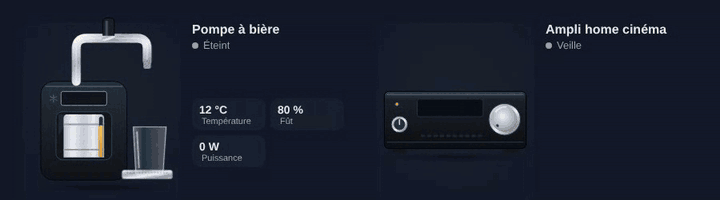

# Beer tap and home cinema amplifier

<p align="center"></p>

**Beer tap** (`custom:appliance-beer-tap-card`): a home draught machine with its keg window, chrome tap and a pint glass.
- **Cooling** (above `threshold`, 30 W): snowflake pulsing, cold mist, condensation on the glass. **Ready** (plug on, below the threshold): full pint with rising bubbles.
- **Pouring** (optional `pouring` sensor on): the handle tilts, beer flows and the glass fills up with its head.
- `temperature` is shown on the display, `keg_level` (%) fills the keg window and warns below `keg_alert` (10 %).

```yaml
type: custom:appliance-beer-tap-card
power: sensor.beer_tap_power
temperature: sensor.beer_tap_temperature   # optional
keg_level: sensor.keg_level                # optional, %
pouring: binary_sensor.beer_pouring        # optional
```

**Home cinema amplifier** (`custom:appliance-av-receiver-card`): an AV receiver with its display, big volume knob and equalizer.
- **Playing**: the equalizer bars dance, the volume ring glows, sound waves and notes come out; the knob position and the bar height follow the volume (`media_player`) or the power drawn (vs `max_power`, 250 W).
- The display shows the source (or the volume); **Muted** shows `MUTE`; **Standby**: red LED.
- With a `media_player`: `on`/`playing` = playing, `paused`, `standby`, `off`, plus `volume_level`, `source`, `is_volume_muted`. With a plug: playing above 40 W, standby from 0.2 W.

```yaml
type: custom:appliance-av-receiver-card
entity: media_player.living_room_avr   # or power: sensor.avr_power
```


[← All cards](../../README.md#the-cards)
