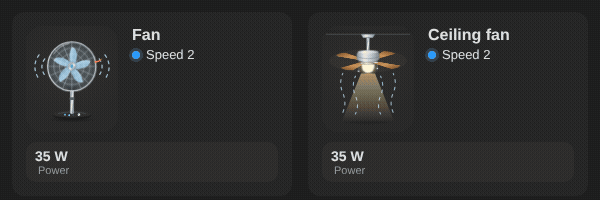

# Ceiling fan

<p align="center"></p>

`custom:appliance-ceiling-fan-card`: a ceiling fan with four wooden blades seen in perspective, the motor housing, a glass light and two pull chains. Three speeds like the pedestal fan (`fan` entity `percentage`, or power: `threshold` 5 W, `mid_threshold` 30 W, `high_threshold` 40 W): the blades turn faster, air flows down and the chains sway. With a `light` entity the glass glows and lights the room below, even when the blades are stopped (status "Lights only").

```yaml
type: custom:appliance-ceiling-fan-card
entity: fan.living_room_ceiling   # or power: sensor.ceiling_fan_power
light: light.living_room_ceiling  # optional
```


[← All cards](../../README.md#the-cards)
