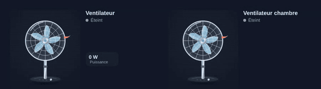

# Fan

<p align="center"></p>

`custom:appliance-fan-card`: a pedestal fan with its cage, five blades and a ribbon. Three speeds: the blades spin faster, airflow lines widen, the ribbon flutters and the base LEDs light up (1, 2 or 3). The head oscillates left and right (`oscillating: false` to stop it).
- With a `fan` entity: `percentage` (≤ 34 % speed 1, ≤ 67 % speed 2, above speed 3) and `oscillating`; the percentage is shown in the status.
- With a smart plug: speed 1 above `threshold` (5 W), speed 2 above `mid_threshold` (30 W), speed 3 above `high_threshold` (40 W).

```yaml
type: custom:appliance-fan-card
entity: fan.bedroom_fan      # or power: sensor.fan_plug_power
```


[← All cards](../../README.md#the-cards)
