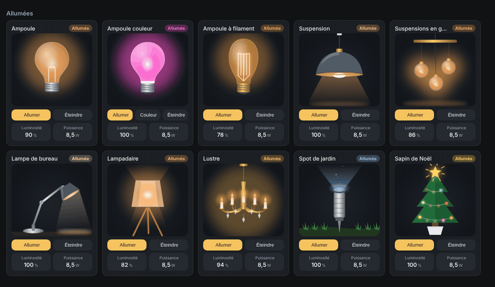

# Lights

`custom:appliance-light-bulb-card · custom:appliance-color-bulb-card · custom:appliance-filament-bulb-card · custom:appliance-pendant-light-card · custom:appliance-pendant-cluster-card · custom:appliance-desk-lamp-card · custom:appliance-floor-lamp-card · custom:appliance-chandelier-card · custom:appliance-garden-spotlight-card · custom:appliance-christmas-tree-card`

<p align="center"></p>

Ten animated light fittings. Off, they show the bare fitting; on, they glow in the light colour, at the brightness of the bulb.

| Card | Animation |
|---|---|
| Bulb (`light-bulb`) | the glass fills with light, the filament glows, a halo breathes around it |
| Colour bulb (`color-bulb`) | frosted glass tinted with the colour; a **Colour** button cycles through presets; colour cycle with `color_cycle: true` or a colour-loop effect |
| Filament bulb (`filament-bulb`) | amber glass, coiled filaments that flicker |
| Pendant light (`pendant-light`) | dome shade, glowing inside, cone of light below |
| Pendant cluster (`pendant-cluster`) | three glass globes that glow and sway gently |
| Desk lamp (`desk-lamp`) | jointed lamp lighting up the desk |
| Floor lamp (`floor-lamp`) | tripod lamp, the fabric shade glows, light falls up and down |
| Chandelier (`chandelier`) | brass chandelier, flickering candle bulbs, sparkling crystals |
| Garden spotlight (`garden-spotlight`) | ground spike spotlight, beam rising with floating dust |
| Christmas tree (`christmas-tree`) | lights twinkling in sequence, glowing star; one colour with `multicolor: false` |

**Colour**: by default the card follows the bulb in Home Assistant (`rgb_color`, otherwise the white temperature in kelvins). Turn off `follow_light_color` to use the colour picked in the editor (`color`); the On button then also sends this colour to the bulb. **Brightness** drives the glow.

With a `light` entity the card shows **On / Off** (and **Colour** on the colour bulb); a `switch` or `input_boolean` works too, as does a power sensor alone (above `threshold`, default 1 W = on).

## Options

- `entity` (light, switch or input_boolean)
- `entity_power`, `entity_energy`
- `color` (RGB, e.g. `[255, 180, 90]`, or a CSS colour)
- `follow_light_color` (default true)
- `color_cycle` (colour bulb, default false)
- `presets` (colour bulb: list of RGB colours for the Colour button)
- `multicolor` (Christmas tree, default true)
- `threshold` (W, without an entity)
- `animations`, `show_status`, `show_controls`, `show_brightness`, `show_power`, `show_energy`
- `language: fr|en|de|nb|nl|ro`

## Example

```yaml
type: custom:appliance-pendant-cluster-card
name: Kitchen island
entity: light.kitchen_island
entity_power: sensor.kitchen_island_power
```

```yaml
type: custom:appliance-chandelier-card
entity: light.dining_room
follow_light_color: false
color: [255, 190, 110]
```

[← All cards](../../README.md#the-cards)
