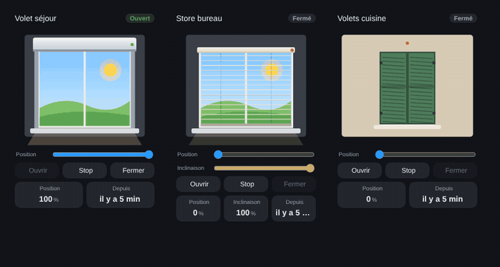

# Shutters and blinds

`custom:appliance-roller-shutter-card · custom:appliance-venetian-blind-card · custom:appliance-swing-shutter-card`

<p align="center"></p>

Three window coverings driven by a `cover` entity. The view through the window follows the sun: day sky with the sun, or night sky with the moon and stars when `sun.sun` is below the horizon.

| Card | Animation |
|---|---|
| Roller shutter (`roller-shutter`) | the aluminium slats roll up into the box at `current_position`; light slits between the slats by day, a beam of light into the room when open |
| Venetian blind (`venetian-blind`) | the slats stack under the head rail as the blind goes up, and turn with `current_tilt_position` (flat = see through, closed = full slats); a **Tilt** slider |
| Swing shutters (`swing-shutter`) | two louvred leaves swing open in 3D on their hinges and fold back against the wall |

The badge shows **Open**, **Closed**, **Open 40 %** or **Closing… 65 %**; while moving, the box LED blinks and an arrow follows the shutter. Buttons **Open / Stop / Close** (Stop hidden if the cover cannot stop), a **Position** slider when the cover supports it, and tiles for position, tilt, motor power and last change. Without `current_position`, open = 100 % and closed = 0 %.

## Options

- `entity` (cover)
- `entity_power` (motor power sensor)
- `sun_entity` (default `sun.sun`; day view if missing)
- `color` (CSS colour of the slats or leaves; defaults: aluminium, beige, green)
- `travel_time` (s, full travel: the drawing moves at the speed of the motor; default 1.2 s per change)
- `invert` (`true` for a cover that reports its position upside down, 0 = open and 100 = closed, as some Tuya shutters do: the drawing, badge, tiles and slider are flipped; the Open / Close buttons are unchanged)
- `animations`, `show_status`, `show_controls`, `show_slider`, `show_position`, `show_tilt`, `show_power`, `show_since`
- `labels` (tile keys: `position`, `tilt`, `power`, `since`)
- `language: fr|en|de|nb|nl|ro|ru`

## Example

```yaml
type: custom:appliance-roller-shutter-card
name: Living room
entity: cover.living_room_shutter
entity_power: sensor.living_room_shutter_power
travel_time: 20
```

```yaml
type: custom:appliance-swing-shutter-card
entity: cover.kitchen_shutters
color: "#3f6f9a"
```

[← All cards](../../README.md#the-cards)
