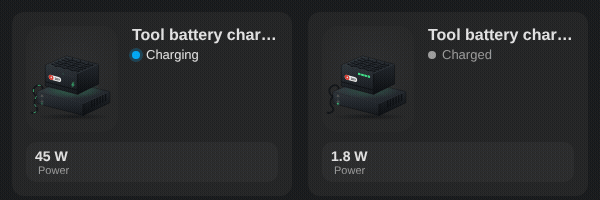

# Tool battery charger

<p align="center"></p>

`custom:appliance-tool-charger-card`: a cordless tool battery (drill, screwdriver…) sitting on its charger, with the power cord, the charger LEDs and the 4-LED charge gauge on the battery.
- **Charging** (power above `threshold`, 10 W by default): the charger LED blinks green, energy flows along the cord, a green glow and a lightning bolt pulse, and the gauge fills up LED by LED.
- **Charged** (power between `standby_threshold`, 1 W by default, and `threshold`, as most chargers draw a little to keep the battery topped up): the four LEDs stay lit.
- **Standby** (below `standby_threshold`, empty charger) and **Off** (switch off).
- Optional `battery_level` (%): the gauge shows the real level (25 % per LED, the next one blinks), a progress bar and a Battery chip are added, and the battery counts as charged from `full_level` (100 % by default).

```yaml
type: custom:appliance-tool-charger-card
power: sensor.workshop_charger_power
switch: switch.workshop_charger      # optional
battery_level: sensor.drill_battery  # optional
```


[← All cards](../../README.md#the-cards)
