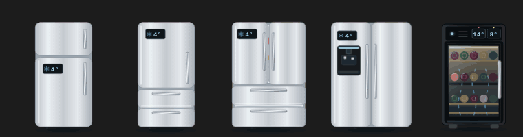

# Wine cooler

`custom:appliance-wine-cooler-card`: a glass-door wine cabinet with bottles on wooden shelves. When the compressor runs (above `threshold`, 15 W) the interior lights up, cold air flows between the bottles, condensation drips on the glass and the LED pulses. On standby the cabinet stays lit; opening the door (`door` sensor) swings it open. The display shows the temperature, and the card warns when it exceeds `max_temperature` (18 °C by default).

```yaml
type: custom:appliance-wine-cooler-card
power: sensor.cave_a_vin_power
temperature: sensor.cave_a_vin_temperature
door: binary_sensor.cave_a_vin_door   # optional
```

# Refrigerator layouts and dual-zone wine cooler

<p align="center"></p>

The refrigerator card has four layouts, chosen with `style` (also in the visual editor):
- `top` (default): freezer on top, fridge below.
- `bottom`: fridge on top, two pull-out freezer drawers below (European combi).
- `french`: two fridge doors on top, two freezer drawers below.
- `american`: side-by-side, freezer on the left with an ice and water dispenser (it lights up and drips while cooling), fridge on the right.

`door` opens the fridge door(s), `freezer_door` opens the freezer door or pulls out the top drawer. Temperatures, alerts and status work the same in every layout.

The wine cooler becomes dual-zone (reds on top, whites below) when you add `zone2_temperature`: a second display, a divider shelf, a cooler lower zone, and an Upper zone / Lower zone chip each. `max_temperature_2` sets the lower zone alert (defaults to `max_temperature`).

```yaml
type: custom:appliance-fridge-card
style: american            # top | bottom | french | american
power: sensor.fridge_power
temperature: sensor.fridge_temperature
door: binary_sensor.fridge_door
freezer_door: binary_sensor.freezer_door
---
type: custom:appliance-wine-cooler-card
power: sensor.wine_cellar_power
temperature: sensor.wine_cellar_red_temperature
zone2_temperature: sensor.wine_cellar_white_temperature
max_temperature: 18
max_temperature_2: 12
```


[← All cards](../../README.md#the-cards)
